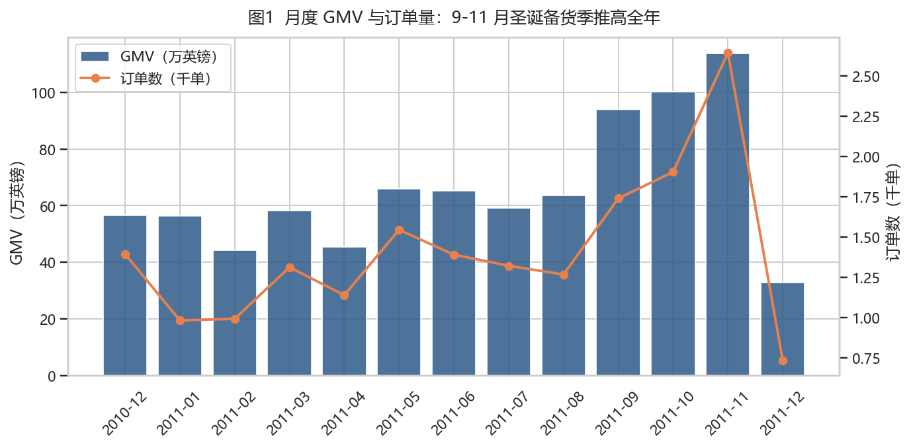
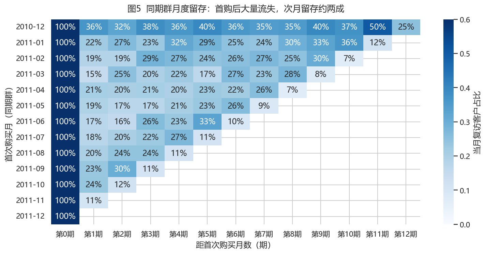
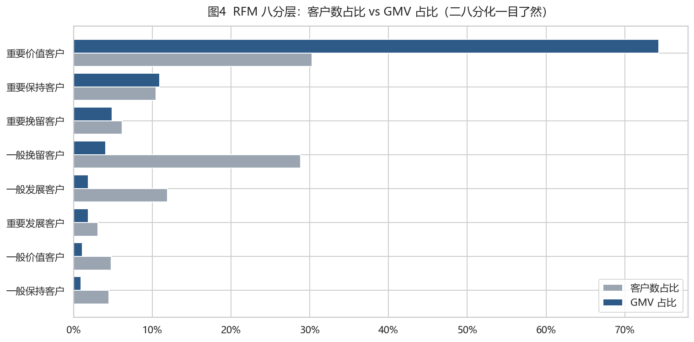

# 英国电商经营诊断分析（Online Retail Business Diagnosis）

> 基于 UCI 公开的英国在线零售商 **54 万行真实交易数据**（2010-12 ~ 2011-12），完成一次从业务问题出发的完整分析闭环：
> **提出业务问题 → 数据清洗 → 多维分析 → 可视化 → 结论与落地建议。**

面向数据分析师岗位的作品项目。所有结论均由本仓库 Notebook 中的真实执行结果产出，可一键复现。

---

## 核心发现速览

| 维度 | 发现 |
| --- | --- |
| 经营 | 总 GMV **£855 万**，9-11 月圣诞备货季推高全年；客单价 £466 稳定，增长动能来自客户数 |
| 客户 | RFM 八分层：**重要价值客户以 30% 人数贡献 74% GMV**，强二八分化 |
| 留存 | 同期群分析：**次月留存仅 20.4%**——80% 客户买一次就走，是最大漏水口 |
| 商品 | 帕累托近似成立：**21.8% 的 SKU 贡献 80% GMV** |
| 市场 | 英国本土 82.6%；海外呈"巨鲸型"（爱尔兰 3 客户 £25.7 万）与"分散型"（德法近百客户）两种结构 |
| 退货 | 退货流水 57% 是平台费冲销！**真实商品退货率 3.50%**（非 7.84%），集中于易碎大件，1 月有圣诞退货潮 |

## 图表一览（节选）







全部 11 张图见 [charts/](charts/)，交互式图表见 [charts/interactive/monthly_trend.html](charts/interactive/monthly_trend.html)。

## 仓库结构

```
├── notebooks/
│   ├── 01_data_cleaning.ipynb        # 数据体检四查 → 逐条清洗（每步附业务理由）→ 清洗报告
│   ├── 02_business_analysis.ipynb    # 7 个业务问题：趋势/RFM/Cohort/商品/市场/时段/退货
│   └── 03_visualization_report.ipynb # 11 张图 + 五条"发现→归因→动作→指标"建议
├── sql/                              # 同一套问题的 MySQL 实现 + SQLite 自动验证
│   ├── 01_build_table.sql            # 建表与数据导入
│   ├── 02_analysis_queries.sql       # 窗口函数版分析（NTILE/CTE/累计和）
│   ├── verify_sqlite.py              # SQL 与 pandas 结果自动比对（免装 MySQL）
│   └── README.md
├── data/
│   ├── raw/                          # 原始数据（UCI 下载，见下）
│   └── cleaned/                      # 清洗后数据与分析中间结果
├── charts/                           # 全部导出图表
├── docs/
│   ├── 项目拆解手册.md                # 逐段拆解：为什么做/怎么做/代码怎么读/面试考点
│   ├── 面试问答手册.md                # 35+ 高频追问与标准答案
│   ├── 项目讲述脚本.md                # 1 分钟 / 3 分钟讲述稿 + 追问接招
│   └── 简历写法.md                   # 项目经历模板与关键词
└── requirements.txt
```

## 快速复现

```bash
pip install -r requirements.txt
# 1. 下载数据（UCI 官网直链，无需注册）
#    https://archive.ics.uci.edu/dataset/352/online+retail
#    解压后将 Online Retail.xlsx 放入 data/raw/
# 2. 依次运行三个 Notebook
jupyter notebook notebooks/01_data_cleaning.ipynb
# 3. （可选）验证 SQL 版本与 pandas 结果一致
python sql/verify_sqlite.py
```

## 数据说明

- **来源**：[UCI Machine Learning Repository — Online Retail](https://archive.ics.uci.edu/dataset/352/online+retail)，真实英国在线零售商交易流水（2010-12-01 ~ 2011-12-09），541,909 行 × 8 字段。
- **清洗口径**：剔除不完整末日与缺失客户 ID 行、拆分退货/取消单、剔除非商品行（运费/平台费/手工调整）与重复行后，销售明细 390,545 行，退货明细 10,617 行；详细口径与每步业务理由见 Notebook 01。
- **局限**：无浏览行为数据（做不了转化漏斗）、无成本数据（毛利未知）、仅 13 个月（同比不可靠）。

## 文档导航

| 文档 | 用途 |
| --- | --- |
| [项目拆解手册](docs/项目拆解手册.md) | 逐段讲透项目：方法论、代码解读、结果解读、面试考点 |
| [面试问答手册](docs/面试问答手册.md) | 35+ 个高频追问的标准答案与加分回答 |
| [项目讲述脚本](docs/项目讲述脚本.md) | 1 分钟 / 3 分钟两档讲述稿 |
| [简历写法](docs/简历写法.md) | 简历项目经历模板与关键词 |
